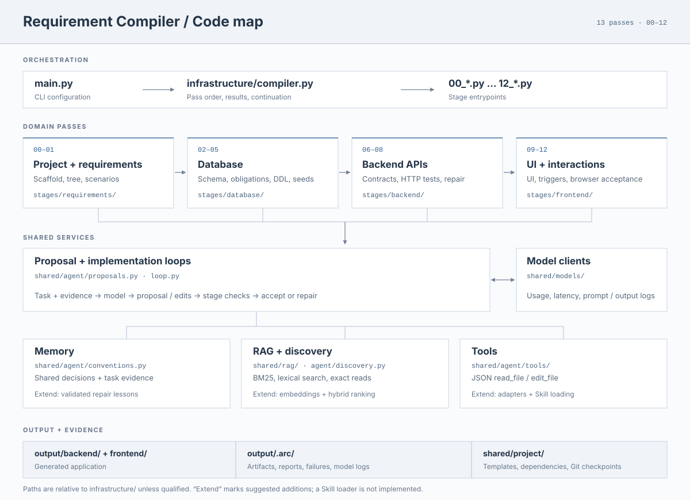

# Requirement Compiler

Compile `requirements.yaml` and reference images into a React + Express + SQLite application through 13 passes: requirements, database schema and obligations, backend APIs and tests, UI, and frontend triggers with end-to-end tests. Intermediate artifacts are saved under the output directory's `.arc/` folder.

## Environment

Install [Python 3.11+](https://www.python.org/downloads/), [Node.js 22.12+ with npm](https://nodejs.org/en/download), and [uv](https://docs.astral.sh/uv/getting-started/installation/). Ensure `node`, `npm`, and `uv` are available in your terminal; reopen it after installation.

Run from the repository root using your platform's shell.

**Windows (PowerShell)**

```powershell
uv sync
if (-not (Test-Path .env)) { Copy-Item .env.example .env }
uv run playwright install chromium
```

**macOS / Linux (bash or zsh)**

```bash
uv sync
if [ ! -f .env ]; then cp .env.example .env; fi
uv run playwright install chromium
```

On supported Debian/Ubuntu Linux systems, use `uv run playwright install --with-deps chromium` instead to also install browser system dependencies; this may require sudo.

If npm needs to compile native dependencies such as `better-sqlite3`, install the platform's build tools:

| Platform | Build tools |
| --- | --- |
| Windows | Visual Studio Build Tools with **Desktop development with C++**, plus Python available to npm. |
| macOS | Xcode Command Line Tools: `xcode-select --install`. |
| Linux | Python, make, and a C++ compiler; on Debian/Ubuntu: `sudo apt-get install python3 build-essential`. |

Set `OPENAI_API_KEY`, `OPENAI_BASE_URL`, and `MODEL` in `.env`. Use a model that accepts image input.

## Run

The input directory must contain `requirements.yaml` and its referenced images. The examples use `input/` and write the generated application to `outputs/demo/`. The commands below work in PowerShell, bash, and zsh.

### Full pipeline

```bash
uv run main.py input --output-dir outputs/demo
```

Add `--model-log` to display and save detailed model input/output, or `--port 33000` to change the backend port (default: 3000). Token usage and model latency are always shown.

### Step by step

Run these commands in order to execute the same 11 passes as the full pipeline. Each command runs only the selected stage and reads existing artifacts from `outputs/demo/.arc/`.

```bash
# 00: Initialize project
uv run main.py input --output-dir outputs/demo --stage 00_project_initialization

# 01: Read requirements and analyze reference images
uv run main.py input --output-dir outputs/demo --stage 01_explore_requirement

# 02: Design database schema
uv run main.py input --output-dir outputs/demo --stage 02_build_db_schema

# 03: Infer database read/write obligations
uv run main.py input --output-dir outputs/demo --stage 03_infer_db_obligations

# 04: Implement database
uv run main.py input --output-dir outputs/demo --stage 04_implement_db

# 05: Design backend APIs including P/Q
uv run main.py input --output-dir outputs/demo --stage 05_design_backend_apis

# 06: Implement backend with test-first acceptance
uv run main.py input --output-dir outputs/demo --stage 06_implement_backend_tdd

# 07: Design UI and frontend data
uv run main.py input --output-dir outputs/demo --stage 07_design_ui

# 08: Implement UI and run existence tests
uv run main.py input --output-dir outputs/demo --stage 08_implement_ui

# 09: Design frontend triggers
uv run main.py input --output-dir outputs/demo --stage 09_design_frontend_triggers

# 10: Implement triggers and run end-to-end tests
uv run main.py input --output-dir outputs/demo --stage 10_implement_frontend_tdd
```

The `--stage` option accepts only a full stage name such as `06_implement_backend_tdd`. Use `uv run main.py --help` to see all stages. Add `--pause` for teaching pauses or `--model-log` for detailed model I/O. Set a custom backend port with `--port` in stage 00.

### Start the generated application

```bash
cd outputs/demo
npm run db:init
npm run build
npm start
```

Open `http://localhost:3000` (or the port you selected).

## Playground

After the environment setup above, build the React interface from the repository root:

```bash
npm --prefix playground install
npm --prefix playground run build
```

Start the local server:

```bash
uv run playground/server.py --port 0
```

Open the URL printed in the terminal. `--port 0` selects an available port; use `--port 45741` for a fixed port. The console loads model settings from the root `.env` file. Input and output paths are relative to the repository root; historical runs are listed from directories under `outputs/` containing `.arc/`.

Rebuild after changing the frontend. Press `Ctrl+C` to stop the server.

## Code map and extension points



Numbered scripts orchestrate each pass. Domain logic lives in `infrastructure/stages/`; shared agent and project services live in `infrastructure/shared/`.

### Module guide

| Module | Entry | Purpose |
| --- | --- | --- |
| Pipeline | [main.py](main.py), [compiler.py](infrastructure/compiler.py) | Configuration, pass order, and reports. |
| Requirements · 00–01 | [requirements/](infrastructure/stages/requirements/), [project/](infrastructure/shared/project/) | Requirement tree and project initialization. |
| Database · 02–05 | [database/](infrastructure/stages/database/) | Schema, obligations, DDL, and seed data. |
| Backend · 06–08 | [backend/](infrastructure/stages/backend/) | API contracts, HTTP tests, and implementation. |
| Frontend · 09–12 | [ui/](infrastructure/stages/frontend/ui/), [triggers/](infrastructure/stages/frontend/triggers/) | UI design, interactions, and browser acceptance. |
| Agent loops | [proposals.py](infrastructure/shared/agent/proposals.py), [loop.py](infrastructure/shared/agent/loop.py) | Model requests, file edits, checks, and repair. |
| Runtime services | [project/](infrastructure/shared/project/), [presentation/](infrastructure/utils/presentation/) | Templates, Git checkpoints, logs, and execution evidence. |

### Extension points

| Area | Current entry | Possible extension |
| --- | --- | --- |
| Memory | [conventions.py](infrastructure/shared/agent/conventions.py) stores shared decisions; task loops retain retrieved evidence. | Store validated repair lessons and retrieve only those relevant to the current task. |
| RAG | [rag/](infrastructure/shared/rag/) provides BM25; [discovery.py](infrastructure/shared/agent/discovery.py) provides lexical search and exact reads. | Add embeddings, hybrid retrieval, or reranking to the relevant retrieval path. |
| Tools | [tools/](infrastructure/shared/agent/tools/) registers and executes `read_file` and `edit_file`. | Add tool schemas, executors, permissions, and observation handling in `loop.py`, including external service adapters. |
| Skills | No loader is implemented. | Select task-relevant `SKILL.md` guidance when assembling prompts, using the existing tools and permissions. |
| Models | [text.py](infrastructure/shared/models/text.py), [vision.py](infrastructure/shared/models/vision.py). | Add providers or select models by task. |
| Acceptance | Domain `testing.py` and runtime modules. | Support other application stacks or execution environments. |

Keep each task focused on one requirement. Retrieve shared knowledge on demand, preserve canonical contracts, and use executable checks to accept changes.
