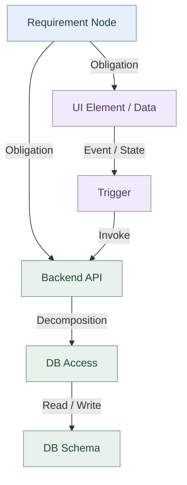

# Requirement Compilation：需求编译的核心思想、形式化定义与完整流程

与传统的 Agentic Software Development 有一个根本区别：

你不是让 LLM 直接理解需求并编写代码，而是将需求视为一种高层程序，将其逐步编译为具有明确语义、数据依赖、接口契约和行为约束的中间表示（IR），最终通过相对确定性的代码生成和局部测试修复得到可运行系统。

其中最关键的概念是 Obligation（义务或必须满足的约束）。它把需求中的自然语言语义转化为编译过程中需要保留、传播、分解和最终实现的责任。

下文分为两个层次：

- 讲义已有的方法：还原当前提出的算法、形式化定义与模块结构。
- 进一步完善的建议：补充讲义中尚未严格定义的机制，使其成为可实现、可验证、可用于论文 Methodology 的编译框架。

## 一、整体编译流程

讲义第 11、14、26、38、40、47 页反复给出了同一个 Progressive Requirement Compilation 算法。它是整个方法的主干：

```
T  ← Parse(requirements)
IR ← ∅

IR ← IR ∪ BuildDBSchema(T)
Ω  ← InferObligations(T, IR)

for pass in [
    BackendAPI,
    DBAccess,
    UIElement,
    UIData,
    Trigger
]:
    P  ← Build(pass, T, IR, Ω)
    IR ← IR ∪ P
    Ω  ← RefineObligations(T, IR, Ω)

assert Resolved(Ω)
return IR
```

这一算法反映了三个重要设计原则。

第一，需求语义优先于实现。 需求首先被解析为结构化的语法树，随后构建语义实体，而不是直接生成代码。

第二，模块之间具有明确的构建顺序。 数据库 Schema 为数据义务提供符号空间，后端 API 声明业务操作边界，DB Access 负责数据实现，UI 与 Trigger 则建立从用户操作到业务功能的连接。

第三，Obligation 贯穿所有 Pass。 每生成一类 Primitive，都需要更新已经满足、需要向下传播或者尚未满足的义务。

这里可以把系统建模为：

[\
\boxed{\mathcal C:T\longrightarrow (IR,\Omega)\longrightarrow A}\
]

其中：

- (T)：Requirement Syntax Tree，即需求语法树。
- (IR)：由多类 Primitive 构成的中间表示。
- (\Omega)：尚需履行或需要证明已履行的语义义务集合。
- (A)：最终生成的可执行应用。

这一点也是你的方法区别于简单多阶段 Prompting 的关键：编译阶段之间传递的不只是自然语言上下文，而是带有明确语义约束的结构化状态。

## 二、核心概念：什么是 Obligation？

### 2.1 基本定义

Obligation 可以理解为：

> 为了满足某个需求，编译器必须确保最终系统实现的特定语义责任。

例如：

需求为：

> 用户可以按照出发地、目的地和日期搜索列车，系统需要显示符合条件的列车名称、出发时间和到达时间。

这段需求隐含着多个必须满足的条件：

- 系统必须能够读取列车时刻表中的相关字段。
- 系统必须根据输入条件筛选数据。
- API 必须返回列车名称、出发时间和到达时间。
- UI 必须展示返回的数据。
- Search 按钮必须触发对应的查询操作。

这些要求不是独立的代码实现建议，而是从需求中推断出来的、实现过程中不能丢失的语义约束。

你当前讲义中的 Obligation 首先被严格限定为 Dataflow Obligation（数据流义务），具体指数据库字段级别的读写需求。

### 2.2 讲义中的形式化定义

第 15–22 页定义了数据库 Schema：

[\
S=\langle\mathcal E,\mathcal R\rangle\
]

其中 (\mathcal E) 是实体集合，(\mathcal R) 是关系集合。

所有数据库字段构成一个数据域：

[\
D(S)={e.a\mid e\in\mathcal E,\ a\in Attr(e)}\
]

需求语法树定义为：

[\
T=\langle N,E\_{\text{contain}},E\_{\text{ref}}\rangle\
]

其中：

- (N)：需求、场景和步骤节点。
- (E\_{\text{contain}})：父子包含关系。
- (E\_{\text{ref}})：引用关系，例如一个场景依赖于另一个场景的执行结果。

然后分别定义读写义务：

[\
O_R,O_W\subseteq N\times D(S)\
]

对单个节点 (n)，有：

[\
O_R(n)={d\mid(n,d)\in O_R}\
]

[\
O_W(n)={d\mid(n,d)\in O_W}\
]

最终：

[\
\boxed{O(n)=\langle O_R(n),O_W(n)\rangle}\
]

这意味着，每一个需求节点都可以映射为一组数据库数据访问需求。

### 2.3 一个具体例子

假设存在以下数据库：

```
Station(
    station_id, name, city, country
)

Train(
    train_id, name, operator
)

TrainSchedule(
    schedule_id, train_id,
    origin_id, destination_id,
    departure_time, arrival_time
)

Booking(
    booking_id, schedule_id,
    passenger_name, seat_no, status
)
```

对于 `Search trains`，其读义务为：

```
requirement: REQ-1.1

read_obligations:
  - Station.station_id
  - Station.name
  - Train.train_id
  - Train.name
  - TrainSchedule.train_id
  - TrainSchedule.origin_id
  - TrainSchedule.destination_id
  - TrainSchedule.departure_time
  - TrainSchedule.arrival_time

write_obligations: []
```

注意，搜索列车不应修改数据库，因此：

[\
O_W(\text{SearchTrains})=\varnothing\
]

这与第 17–20 页逐步推断数据义务的实例一致。字段集表示的是需要访问哪些数据，不表示实际 SQL 的执行顺序。

### 2.4 Obligation 的三个关键特征

1\. Obligation 是声明性的，而不是过程性的。

例如，`TrainSchedule.departure_time` 属于读义务，只表示系统必须具备读取该字段的能力，不规定必须通过 SQL Join、ORM 还是缓存实现。

2\. Obligation 是可传播的。

一个高层需求的读写义务，可以传播到其子场景、API、DB Access Primitive 等具体模块。

3\. Obligation 是可以检查的。

如果某个需求需要读取 `Train.name`，但生成的 API 和 DB Access 均未覆盖该数据依赖，就可以识别出未履行的义务。

由此，你实际上为需求编译引入了一种独立于具体实现语言的数据语义约束机制。

## 三、Obligation 如何在需求树中传播？

讲义的第 21–22 页引入了两条关键规则：Obligation Conservation 和 Obligation Reference。

这两条规则可以视为需求编译过程中最基础的数据流分析规则。

### 3.1 Obligation Conservation：义务守恒

假设一个父需求被分解为若干子需求：

```
REQ-1: Train Booking
├── REQ-1.1: Search Trains
├── REQ-1.2: Select Train
└── REQ-1.3: Confirm Booking
```

讲义规定：

[\
\boxed{O_X(p)=\bigcup\_{c\in Children(p)}O_X(c)}\
]

其中 (X\in{R,W})。

含义是：父节点的全部读写义务，必须由其子节点共同承担。

例如：

| 节点                 | 读义务                         | 写义务     |
| ------------------ | --------------------------- | ------- |
| Search Trains      | Station、TrainSchedule、Train | ∅       |
| Select Train       | TrainSchedule               | ∅       |
| Confirm Booking    | TrainSchedule、Booking       | Booking |
| Train Booking（父节点） | 上述读义务的并集                    | Booking |

这里的核心不是父节点与子节点拥有相同的代码，而是父节点所承诺的行为，在分解之后不能凭空消失。

不过，如果希望这条规则支持严格的编译正确性证明，我建议区分两个概念：

- `Required Obligations`：该节点在语义上必须满足的义务。
- `Allocated Obligations`：编译器分配给具体子模块去实现的义务。

对于一个已经完整分解的父节点，可以要求：

[\
O_X^{req}(p)\subseteq\
\bigcup\_{c\in Children(p)}O_X^{alloc}(c)\
]

再要求生成的子模块不存在未被授权的额外副作用。

这样比直接使用集合相等更稳健，因为一个实现可能需要额外的内部数据访问，例如用于连接数据库表的主键；这些访问不一定直接来自用户需求。

### 3.2 Obligation Reference：引用传播

考虑这样的场景：

```
STEP-1.2.1: Select Train

Given:
    Search results are displayed.
    reference: REQ-1.1

When:
    The user selects a train.

Then:
    The selected train is ready for booking.
```

当前步骤引用了 `REQ-1.1`，表示选择列车之前，需要具备前面搜索场景提供的数据或执行状态。

讲义定义：

[\
(n\xrightarrow{ref}m)\
\Rightarrow\
O_R(m)\subseteq O_R(n)\
\land\
O_W(m)\subseteq O_W(n)\
]

也就是：引用节点继承被引用节点的读写义务。

由此：

[\
O(n)=O^{local}(n)\cup O^{ref}(n)\
]

对于 `Select Train`：

```
Local obligations:
    Train.train_id
    TrainSchedule.schedule_id

Referenced obligations:
    SearchTrains 的数据义务
```

因此，步骤完整的数据依赖既包含本地选择行为，又包含先前搜索产生的数据。

这里有一个值得研究的重要区别。

引用前一个步骤，并不一定意味着需要重新执行它所需的全部数据库读写操作。

例如搜索完成以后，用户选择的是已有的 UI 搜索结果。这时需要继承的是前一步的输出数据及其有效性，而不一定是底层的所有数据库访问。

因此，我建议后续将 Reference 分成两种语义：

1. Data Dependency：引用前一个步骤产生的数据。
2. State Dependency：要求前一个步骤建立的应用状态已经成立。

这样，原先的字段级 Obligation 可以进一步扩展成更精确的跨场景依赖关系。

## 四、完整的需求编译步骤

下面按照编译器真正执行时的顺序，把每个 Pass 的输入、执行动作、输出和检查条件展开。

步骤 1–7 主要对应讲义提出的机制；步骤 8–10 将讲义中的测试驱动、代码生成思想组织为更明确的工程阶段。

### Step 1. Requirement Parsing：需求解析

目标： 将自然语言与结构化需求文档转换为统一的 Requirement AST。

讲义第 12–13 页给出的模型包含三个核心语义实体：

- `Requirement`：需求节点，能够递归分解。
- `Scenario`：描述一个业务场景。
- `Step`：由 Given、When、Then 构成的行为描述。

并存在两类关系：

- `Contain`：节点之间的层次包含关系。
- `Reference`：跨节点的显式依赖关系。

编译结果可表示为：

[\
T=\langle N,E\_{\text{contain}},E\_{\text{ref}}\rangle\
]

示例：

```
id: REQ-1
name: Train Booking

children:
  - id: REQ-1.1
    name: Search Trains
    description: >
      Search by origin, destination and date.

    scenarios:
      - id: SCE-1.1
        name: Search Trains
        steps:
          - id: STEP-1.1.1
            given: Valid search criteria.
            when: User clicks Search.
            then: Matching trains are displayed.

  - id: REQ-1.2
    name: Select Train
    scenarios:
      - id: SCE-1.2
        steps:
          - id: STEP-1.2.1
            given: Search results are displayed.
            references:
              - REQ-1.1
            when: User selects a train.
            then: Train is selected for booking.
```

这里的工作不仅是 YAML 解析，还包括标识符解析、引用检查、依赖检查，以及自然语言片段与 AST 节点的关联。

输出： `Requirement AST`。

验证： 节点 ID 唯一、引用目标有效、需求层次结构合法、场景结构完整。

### Step 2. DB Schema Synthesis：数据库 Schema 构造

目标： 从整个需求树中推断全局数据模型，为后续编译提供稳定的数据库符号空间。

讲义第 15–25 页展示了先构建 Schema，再基于 Schema 推断数据义务的过程，同时给出了局部增量式 Schema 生成的 Agent 工作机制。

例如：

```
Entity:
  Train
  Station
  TrainSchedule
  Booking

Relationships:
  TrainSchedule.train_id -> Train.train_id
  TrainSchedule.origin_id -> Station.station_id
  Booking.schedule_id -> TrainSchedule.schedule_id
```

建议这一阶段内部采用以下顺序，以降低反复修改 Schema 的概率：

1. Entity Discovery：确定数据实体。
2. Attribute Inference：为实体推断必要字段。
3. Relationship Synthesis：确定实体间关系和基数。
4. Constraint Synthesis：推断主键、外键、唯一性、非空约束等。
5. Schema Validation：检查数据模型是否足以支撑需求。
6. Incremental Refinement：对于尚不能满足的数据需求，修改现有 Schema。

尤其是第 25 页的图非常重要：它将数据义务作为 Agent 的约束输入，将部分 Schema 作为持久状态，使 Agent 对已有模型进行局部修改，而不是每次重新生成整个数据库。

输出：

[\
IR\_{DB}=\langle Entities,Attributes,Relations,Constraints\rangle\
]

验证： 引用字段存在、关系完整、关键约束不冲突，数据库模型能够支撑已经识别的数据需求。

### Step 3. Dataflow Obligation Inference：数据流义务推断

目标： 为每个需求节点推断其必须读取、写入的数据字段。

输入为：

[\
(T,IR\_{DB})\
]

输出为：

[\
\Omega\_{DB}={O_R(n),O_W(n)\mid n\in N}\
]

处理过程：

1. 从每个节点的需求描述中识别数据访问语义。
2. 将自然语言中的数据概念绑定到 DB Schema 中的实体和字段。
3. 为节点建立局部读写义务。
4. 沿着 `Contain` 关系聚合义务。
5. 沿着 `Reference` 关系传播义务。
6. 检查是否有无法映射到数据库字段的需求。

例如：

```
Requirement:
    Display train name, departure and arrival time.

Required data:
    train_name
    departure_time
    arrival_time

Schema mapping:
    train_name     -> Train.name
    departure_time -> TrainSchedule.departure_time
    arrival_time   -> TrainSchedule.arrival_time
```

这里可以使用 LLM 完成自然语言概念与数据库符号的匹配，但随后应通过编译器执行符号存在性检查。

输出： 各需求节点的数据访问义务，以及语义概念到数据库字段的绑定关系。

验证： 所有已声明的数据义务都有合法的数据符号，不能静默丢弃无法解析的字段。

### Step 4. Backend API Synthesis：后端 API 合成

这一阶段是你的方法中形式化程度最高的部分之一，对应讲义第 27–37 页。

目标： 将需求中的业务行为分解为可调用的后端 API，并为每个 API 推断接口契约。

讲义定义 API Primitive 为：

[\
\boxed{API=\langle signature,I,O,R,W,P,Q\rangle}\
]

| 字段          | 语义                         |
| ----------- | -------------------------- |
| `signature` | API 名称、参数及返回类型             |
| `I`         | Request/Input，输入数据         |
| `O`         | Response/Output，输出数据       |
| `R`         | 必须读取的数据库数据                 |
| `W`         | 必须写入的数据库数据                 |
| `P`         | Precondition，调用前必须满足的条件    |
| `Q`         | Postcondition，正常执行后必须成立的结果 |

例如：

```
id: API-SearchTrains
signature: SearchTrains(origin, destination, date)

input:
  origin: string
  destination: string
  date: date

output:
  trains:
    type: array
    items:
      train_id: string
      train_name: string
      departure_time: datetime
      arrival_time: datetime

read:
  - Station.name
  - Train.name
  - TrainSchedule.origin_id
  - TrainSchedule.destination_id
  - TrainSchedule.departure_time
  - TrainSchedule.arrival_time

write: []

precondition:
  - origin is not empty
  - destination is not empty
  - date is valid

postcondition:
  - every result matches origin and destination
  - every result departs on the requested date
```

这里需要完成三项工作。

4.1 API Decomposition：API 拆解

确定一个需求由哪些 API 负责。

例如：

[\
API(STEP\text{-}1.1.1)={SearchTrains}\
]

但复杂场景可以拆成多个 API，例如确认订单可能需要获取可用座位、创建订单以及读取订单详情。

4.2 Obligation Propagation：义务分配

讲义第 30 页给出：

[\
\boxed{O_X(step)=\bigcup\_{i=1}^{k}O_X(API_i)}\
]

也就是，所有 API 共同承担该需求步骤的数据义务。

需要注意，这是一个已经确定完整 API 分解后的义务守恒条件，而不应误认为每一个 API 都必须实现父节点的所有义务。

4.3 Contract Inference：契约推断

讲义第 32–35 页将其拆解为：

- Signature Inference
- Request Inference
- Response Inference
- Precondition Inference
- Postcondition Inference

这一设计非常重要，因为它把单个 API 从一段自然语言功能描述转化为具有明确输入、输出和可检查行为的模块。

输出： Backend API Primitive IR。

验证： API 组合能够覆盖需求义务、输入输出类型一致、前置条件合理且后置条件能够体现需求语义。

### Step 5. DB Access Synthesis：数据访问操作生成

对应讲义第 39 页。

目标： 将 API 的数据访问义务分解为底层数据库操作 Primitive。

讲义定义：

[\
\boxed{A=\langle kind,I,O,R,W,P,Q\rangle}\
]

其中：

[\
kind\in{SELECT,INSERT,UPDATE,DELETE}\
]

例如，对于 `SearchTrains`：

```
id: DB-QueryTrains
kind: SELECT

input:
  origin: string
  destination: string
  date: date

output:
  rows: TrainSummary[]

read:
  - Train.name
  - TrainSchedule.origin_id
  - TrainSchedule.destination_id
  - TrainSchedule.departure_time
  - TrainSchedule.arrival_time

write: []

precondition:
  - valid search criteria

postcondition:
  - returned rows satisfy requested filters
```

在这一阶段，API 的抽象读写义务被分解为数据库层可执行的数据访问操作。

例如：

```
SearchTrains API
        |
        v
QueryMatchingSchedules DB Access
        |
        v
Train + TrainSchedule + Station
```

这里我建议进一步明确 API 与 DB Access 的组合关系。

API 不仅包含数据库操作，也可能进行：

- 参数校验。
- 数据转换。
- 业务规则计算。
- 多个 DB Access 的组合。
- 异常处理和事务管理。

因此 API 语义不能简单等同于底层 SQL，而应该要求：

[\
Sem(Compose(DBAccess_1,\ldots,DBAccess_k))\
\models Contract(API)\
]

也就是：底层操作按照指定顺序组合后，必须满足上层 API 的契约。

输出： DB Access Primitive IR，以及 API 到 DB Access 的调用关系。

验证： 数据访问覆盖、数据库约束、类型兼容性和业务前后置条件。

### Step 6. UI Element & Data Synthesis：界面和 UI 数据合成

对应讲义第 41–46 页。

目标： 根据需求描述、视觉参考和 API 契约，构建 UI 组件树及相关状态变量。

讲义定义：

[\
\boxed{ui=\langle id,type,parent,mode,data,prop\rangle}\
]

其中：

- `id`：UI 控件标识符。
- `type`：控件类型，例如 Page、Input、Checkbox。
- `parent`：父组件。
- `mode`：用户对数据的读写模式。
- `data`：UI 绑定数据，包含变量、类型和约束。
- `prop`：组件的静态属性。

例如：

```
elements:
  - id: SearchPage
    type: Page

  - id: OriginInput
    type: Input
    parent: SearchPage
    data:
      var: origin
      dtype: string
      constraints:
        - required

  - id: SearchButton
    type: Button
    parent: SearchPage
    prop:
      text: Search

  - id: TrainResultList
    type: List
    parent: SearchPage
    data:
      var: trains
      dtype: TrainSummary[]
      mode: user_read
```

讲义第 45 页给出的机制值得特别保留：增量式 UI Tree Synthesis。

即 Agent 不是一次性生成所有界面，而是以当前 Requirement Node 为工作单元，读取已有的 UI Tree，在保留既有元素的前提下新增控件或修改可见性配置。

这能够避免独立处理多个需求时，重复生成相似页面或破坏已有组件结构。

输出： UI Element Tree 与 UI Data Symbols。

验证： 控件类型、父子结构、数据绑定和约束一致性，以及参考图中的结构是否得到合理表示。

### Step 7. Trigger Synthesis：交互事件合成

对应讲义第 48–52 页。

目标： 建立用户交互、前端状态和后端 API 之间的行为连接。

讲义定义：

[\
\boxed{tr=\langle id,source,event,guard,read,action,write\rangle}\
]

| 字段       | 含义                      |
| -------- | ----------------------- |
| `id`     | Trigger 唯一标识            |
| `source` | 触发事件的 UI 元素             |
| `event`  | click、change、submit 等事件 |
| `guard`  | 事件执行的前置条件               |
| `read`   | 事件读取的 UI 状态             |
| `action` | 执行 API 调用或本地操作          |
| `write`  | 事件更新的 UI 状态             |

例如：

```
id: TR-SearchTrains

source: SearchButton
event: click

guard:
  - origin is not empty
  - destination is not empty
  - date is valid

read:
  - origin
  - destination
  - date

action:
  kind: api_call
  target: API-SearchTrains

write:
  - trains
  - loading
  - error
```

这个 Primitive 可以对应到以下执行流程：

```
用户点击 Search
        |
        v
读取 origin / destination / date
        |
        v
检查 guard
        |
        v
调用 SearchTrains API
        |
        v
读取 API response
        |
        v
更新 trains UI 状态
        |
        v
TrainResultList 重新渲染
```

这一阶段实际上完成了前后端语义连接。

还应检查 API 输入与 UI 状态之间的映射，以及 API 输出与 UI Data 之间的绑定关系。

例如：

[\
tr.read \supseteq API.input\
]

这里的包含关系是在完成参数映射后理解的，并非要求 UI 变量名与 API 输入字段名完全一致。

相应地，API 返回数据必须能被 Trigger 传递给对应 UI 状态，再由 UI 控件使用。

输出： Trigger Primitive IR。

验证： UI 事件存在、目标 API 可调用、数据类型兼容、Guard 与 API Precondition 一致、响应能写入合法的 UI Data Symbol。

### Step 8. Constraint Enforcement：约束检查与测试生成

这一步不是等到代码全部生成之后才执行，而是从 Backend API Pass 开始，贯穿后续各阶段。

讲义第 36–37 页明确提出：

> TDD-driven for enforcing pre-condition, post-condition, and dataflow obligations.

因此，每一类可执行 Primitive 都可以建立对应的测试。

| 约束来源               | 生成的测试      | 示例                |
| ------------------ | ---------- | ----------------- |
| Precondition       | 输入合法性测试    | 空出发地应被拒绝          |
| Postcondition      | 行为结果测试     | 返回的车次必须匹配查询条件     |
| Read Obligation    | 数据读取与关联测试  | 查询正确访问车次和时刻表数据    |
| Write Obligation   | 状态修改与持久化测试 | 创建订单后数据库存在订单      |
| UI Data Constraint | UI 数据校验测试  | 必填输入为空时显示错误       |
| Trigger Contract   | 事件与交互测试    | 点击 Search 后结果列表更新 |

需要明确，字段访问义务可以通过静态分析、SQL 检查、Mock 或集成测试辅助验证，但仅通过普通功能测试，通常无法穷尽证明所有内部数据访问行为正确。

这里的 TDD 不是简单的“生成测试，再生成代码”，而是：

[\
\text{Contract}\
\rightarrow\text{Test}\
\rightarrow\text{Implementation}\
\rightarrow\text{Feedback}\
]

其中测试的依据是 IR 中的形式化约束，而不是再让 LLM 从原始自然语言独立猜测需要测试什么。

### Step 9. Code Generation：从 IR 到代码

讲义第 53 页展示了从同一组 Primitive 生成不同框架代码的过程：

- Frontend：React、Vue。
- Backend：Node.js、J2EE 等。

这意味着 IR 应尽可能表达平台无关的应用语义，而由后端代码生成器负责具体框架适配。

例如：

```
Trigger Primitive
      |
      +-- React Generator
      |       └── onClick / useState / fetch
      |
      +-- Vue Generator
              └── @click / ref / axios
```

同样：

```
Backend API Primitive
      |
      +-- Express Generator
      |       └── router / controller
      |
      +-- Spring Generator
              └── @RestController / @Service
```

理想情况下，这一步尽量使用确定性的规则生成：

- 项目结构。
- 类型声明。
- API 路由及签名。
- 数据模型。
- UI 组件结构。
- 事件绑定。
- 模块间调用关系。

但讲义目前还没有详细定义代码生成器的规则、正确性条件及所有 Primitive 的可执行语义。

尤其是 API 中的业务逻辑，如果仅有 ((I,O,R,W,P,Q))，可能还无法唯一决定具体算法。这一点需要在后续 IR Refinement 中解决。

### Step 10. Integration & Acceptance Validation：集成与验收

最终需要从三个层次验证生成的应用。

Primitive-level：每个底层模块符合自己的契约。

Integration-level：API、DB Access、UI 和 Trigger 之间的组合正确。

Requirement-level：整个可执行系统满足原始需求场景。

例如对于 `Search Trains`：

```
GIVEN:
  User opens the Search page.

WHEN:
  User enters origin, destination, date,
  and clicks Search.

THEN:
  Matching trains are displayed,
  including name, departure and arrival time.
```

这个端到端场景检查的是集成应用的外部可观察行为，而不是仅测试某个 API 的局部实现。

这也完成了从源需求到可执行应用的闭环：

[\
Requirement\
\xrightarrow{Compilation}\
IR\
\xrightarrow{CodeGen}\
Application\
\xrightarrow{Acceptance}\
ObservedBehavior\
]

## 五、把所有 Primitive 组织成统一的 IR

前面逐步构造了五类主要 Primitive。它们不是五份互不相关的文档，而应共同构成一个具有跨模块引用关系的中间表示。

| Primitive       | 描述的语义        | 核心约束                          |
| --------------- | ------------ | ----------------------------- |
| DB Schema       | 数据的结构与关系     | 字段、外键、约束                      |
| Backend API     | 系统对外提供的业务操作  | I/O、R/W、P/Q                   |
| DB Access       | 数据库原子访问操作    | Kind、R/W、P/Q                  |
| UI Element/Data | 用户可见界面和前端状态  | 类型、层级、数据绑定                    |
| Trigger         | 用户交互与业务操作的连接 | Event、Guard、Read/Write、Action |

它们最终形成这样的依赖网络：

````

````

这里有一个我认为非常值得明确的概念：

Primitive 是具有明确语义和契约的最小编译实体，而 Obligation 是约束这些 Primitive 必须满足哪些需求语义的机制。

两者不是同一个层面的东西。

- Primitive 描述“生成的系统由哪些语义构件组成”。
- Obligation 描述“这些构件必须承担什么责任”。
- Contract 描述“单个构件具体承诺什么行为”。
- Verification 描述“如何确认这些责任得到实现”。

因此，你的 IR 不是普通的架构设计图，而可以进一步发展为一个 Contract-Carrying IR（携带契约的中间表示）。

这也是我认为最有潜力的理论抽象之一。

## 六、建议补充：Obligation 的生命周期

这一部分是我基于讲义提出的扩展，不是讲义中已经完整定义的机制。

目前的算法中：

```
Ω ← InferObligations(T, IR)
Ω ← RefineObligations(T, IR, Ω)

assert Resolved(Ω)
```

但还需要回答一个问题：

什么条件下才能认定一个 Obligation 已经被 Resolved？

仅仅生成了一个声明有相应 `R/W` 的 API，并不能证明数据库访问已经实现，更不能证明外部行为符合需求。

我建议将一个 Obligation 的生命周期明确定义为：

Inferred

从需求推断

Allocated

分配给 Primitive

Verified

通过约束验证

Implemented

已经生成实现

对于每个 Obligation，可以存储这样的元数据：

```
id: OBL-001
origin: REQ-1.1
kind: DB_READ

target:
  - Train.name
  - TrainSchedule.departure_time

allocated_to:
  - API-SearchTrains
  - DB-QueryTrains

status: verified

evidence:
  - TEST-DB-QueryTrains
  - TEST-API-SearchTrains
```

这样，`Resolved(Ω)` 就不再是一个模糊的布尔判断，而可以依据具体的验证状态和证据进行检查。

不过，需要明确区分测试通过与形式化证明完成。二者提供的保障强度不同；只有验证过的性质才应标记为获得相应级别的保证。

## 七、建议补充：从 Dataflow Obligation 扩展到 Semantic Obligation

目前讲义中最严格的 Obligation 定义是数据库字段层面的读写集合。

这已经能够约束数据库与 API 的数据访问，但还不足以完整表示需求语义。

例如：

> 用户只能取消自己的订单。

其数据库读写义务可能是：

[\
O_R={Booking.user_id,Booking.status}\
]

[\
O_W={Booking.status}\
]

但这些义务本身不能保证：

[\
Booking.user_id=CurrentUser.id\
]

因此，仅具有正确的 R/W 集合，仍可能实现错误的业务逻辑。

我建议从形式化层面区分以下几种义务。

| Obligation 类型 | 定义           | 典型示例                |
| ------------- | ------------ | ------------------- |
| Dataflow      | 必须访问的数据      | 读取 `Booking.status` |
| Contract      | 操作必须满足的前后置条件 | 只能取消自己的订单           |
| State         | 应用状态转换约束     | Pending → Cancelled |
| UI            | 用户应能观察或输入的数据 | 显示订单状态              |
| Interaction   | 用户事件必须触发的行为  | 点击 Cancel 调用 API    |
| Temporal      | 跨步骤或跨请求的行为约束 | 取消后刷新仍显示已取消         |

例如订单取消，可以描述为：

[\
P:\
booking.owner=currentUser\
\land booking.status=Pending\
]

[\
Q:\
booking.status=Cancelled\
]

再使用 Hoare Triple：

[\
\boxed{{P}\ CancelBooking\ {Q}}\
]

对于该 API，R/W Obligation 约束访问的数据范围，Hoare Contract 约束行为逻辑，二者是互补关系。

因此，一个更完整的语义义务集合可以表示为：

[\
\Omega=\
\Omega\_{data}\
\cup\Omega\_{contract}\
\cup\Omega\_{state}\
\cup\Omega\_{ui}\
\cup\Omega\_{interaction}\
\cup\Omega\_{temporal}\
]

这里的扩展不要求一开始就支持所有种类。你可以保留 Dataflow Obligation 作为第一阶段的理论核心，再逐步覆盖其他语义类别。

## 八、目前方法中需要进一步明确的五个理论问题

这些是我认为在写论文和实现编译器时最值得优先解决的问题。

### 1. Obligation Conservation 是集合相等，还是语义覆盖？

讲义使用：

[\
O(p)=\bigcup_i O(c_i)\
]

但如果底层操作需要额外的字段，例如用于 Join 的 `train_id`，那么它可能超出用户直接要求的数据集合。

因此，需要确定 Obligation 是精确数据访问集合，还是最低数据需求集合，并明确额外访问的合法性。

### 2. Obligation Reference 是否意味着完整继承？

讲义中引用节点继承被引用节点的 R/W Obligation。

但若前一步完成了订单创建，后一步只是显示创建结果，不应因此再次执行 INSERT。

因此需要明确：

- 哪些数据被引用？
- 引用的是已产生的结果，还是需要重新执行的操作？
- 前序步骤建立了什么状态？
- 引用时有哪些状态不变量必须继续保持？

### 3. Primitive 的 P/Q 是否足以表示行为语义？

对于简单的查询操作，P/Q 可能已经足够约束预期行为。

但对于包含分支、循环、多次 DB Access、事务和错误处理的复杂 API，仅依靠 I/O/R/W/P/Q，未必足以指导确定性代码生成。

可能需要引入低层 Control-flow IR 或 Operational Semantics，用于表示具体的执行步骤。

这可以自然形成两个层级：

[\
\underbrace{Contract\ IR}*{What}*\
*\longrightarrow*\
*\underbrace{Operational\\ IR}*{How}\
\longrightarrow Code\
]

其中，高层 IR 描述系统需要满足的语义，低层 IR 描述可执行操作及其组合方式。

### 4. 各类 Primitive 的顺序是否总是固定？

讲义规定：

```
DB Schema
    ↓
Backend API
    ↓
DB Access
    ↓
UI Element
    ↓
UI Data
    ↓
Trigger
```

这是合理的初始拓扑顺序，但不一定适用于所有需求。

例如，某些需求首先由 UI 操作推断出业务行为，随后才发现需要新增 API 和 Schema 字段。

因此，可以保留这一固定顺序作为主要编译 Pass，同时允许出现 Obligation 未满足时重新执行受影响的 Pass，直到达到稳定状态或报告无法解决的冲突。

### 5. 如何定义真正的 Compilation Correctness？

讲义中的 `Resolved(Ω)` 是一个自然的结束条件，但理论上仍需要证明或验证：

[\
Sem(CodeGen(IR))\models Requirements\
]

需要注意，测试通过无法在一般情况下证明该公式成立。

更实际的正确性论证可以分为三层：

- Structural Correctness：所有 Primitive 和引用关系在结构上合法。
- Contract Consistency：模块契约之间兼容，分解后的义务得到覆盖。
- Behavioral Validation：生成应用通过相应测试，提供其行为符合需求的实验证据。

这三层组合起来，可以形成一个从需求语义到应用行为的逐层验证体系。

## 九、将整个方法提炼成一个更严格的编译器架构

综合讲义已有内容与前面的扩展，我建议用下面的十个阶段组织实现。

| 阶段                      | 主要输入                 | 主要输出                   | 核心工作         |
| ----------------------- | -------------------- | ---------------------- | ------------ |
| 1. Parsing              | Requirement Document | Requirement AST        | 结构化解析        |
| 2. Schema Synthesis     | AST                  | DB Schema IR           | 全局数据建模       |
| 3. Obligation Inference | AST + Schema         | Obligation Set         | 推断数据与行为约束    |
| 4. API Synthesis        | AST + Obligations    | API Contract IR        | 操作拆解与接口契约    |
| 5. DB Access Synthesis  | API IR + Schema      | DB Access IR           | 数据访问分解       |
| 6. UI Synthesis         | AST + API IR         | UI Element/Data IR     | 界面与状态合成      |
| 7. Trigger Synthesis    | UI IR + API IR       | Trigger IR             | 交互行为连接       |
| 8. IR Validation        | 所有 IR                | Validated IR           | 义务覆盖与契约一致性检查 |
| 9. Lowering & CodeGen   | Validated IR         | Application Code       | 语义细化与代码生成    |
| 10. Testing & Repair    | Code + Contracts     | Executable Application | 约束驱动的局部测试修复  |

其中，阶段 1–7 对应讲义的主体流程。阶段 8–10 是建议进一步独立化、规范化的工程阶段。

从论文研究角度，可以将方法压缩为三个大的技术部分：

（1）Requirement-Guided Semantic Analysis

构造 Requirement AST、数据库符号空间与 Obligation，并通过需求结构和引用关系进行语义传播。

（2）Obligation-Constrained Progressive IR Synthesis

在一系列编译 Pass 中构建 DB、API、UI、Trigger 等 Primitive，以语义义务限制 LLM 的局部决策，并保证模块之间的契约一致性。

（3）Contract-Driven Lowering and Validation

将高层语义 IR 转换为可执行操作和具体代码，使用契约驱动的测试与反馈修复生成结果。

## 十、最后总结：你的思想最核心的创新主张

我认为你的需求编译方法可以提炼成一句话：

> Requirement Compilation progressively translates requirement semantics into executable software primitives, while propagating and enforcing semantic obligations to preserve requirement satisfaction across compilation stages.

中文可以表述为：

需求编译通过渐进式构建具有明确语义契约的软件原语，并在各个编译阶段传播与约束需求义务，实现从高层需求到可执行软件的系统化转换。

我认为这里最有价值的并非某个特定的 IR 数据结构，而是以下三个机制的结合：

1. Obligation Propagation：让需求中的语义责任能够跨越需求层次、API、数据库以及前端模块进行传递。
2. Progressive Primitive Synthesis：将复杂的软件生成任务拆解为一组具备明确输入、输出、约束和依赖关系的编译 Pass。
3. Contract-Driven Verification：通过前后置条件、数据义务和测试反馈，约束每个局部模块的实现。

其中，Obligation 是整个方法的核心连接机制：它连接了自然语言需求、语义 IR、模块契约和验证过程。

接下来最值得优先形式化的是两个问题：Obligation 究竟表示何种语义责任，以及何时能够证明一个 Obligation 被正确履行。 只要这两个定义足够严格，你的 Requirement Compilation 就有机会从一套合理的 Agent 工作流，进一步发展为具有明确编译不变量和正确性论证的编译方法。